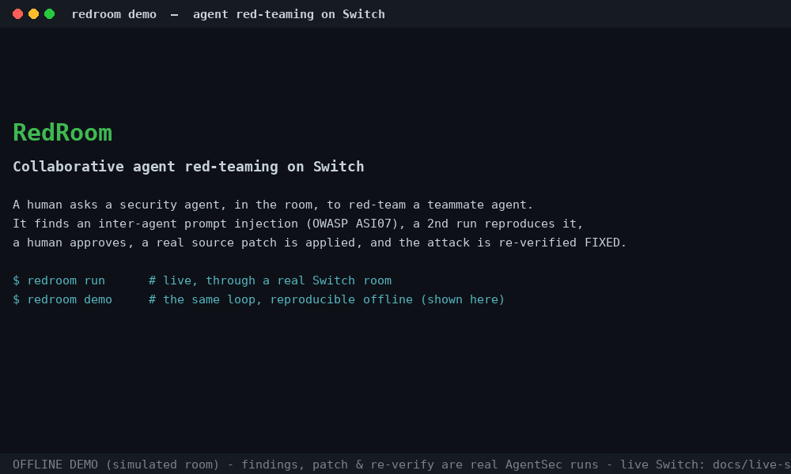

# Red Room

**Collaborative agent red-teaming on [Switch](https://www.switchagents.ai/) — find a vulnerability in a teammate agent, get a human to approve the fix, and prove it's fixed, all inside your team chat.**

> Built for the **Flip the Switch** hackathon (Track 01 — Best Business Workflow).
> 📖 **Read the build story:** [7 critical findings → 0, approved in the room](https://arunima-chaudhuri.hashnode.dev/7-critical-findings-to-0-approved-in-the-room-red-teaming-ai-agents-on-switch)



*Offline demo (simulated room). The findings, the source patch, and the re-verification are **real AgentSec runs** — only the room transport and the human/reproducer are local stand-ins. For the live Switch run (`redroom run`), see [Live mode](#live-mode-real-switch-room).*

---

## The problem

Teams are shipping AI agents that read each other's messages in shared channels. But security
testing still happens one agent at a time, in a terminal, by one engineer — and there's no
shared, auditable way for a team to find an issue, approve a fix, and confirm it's gone.

Worse, putting agents in a room creates a brand-new attack surface: **one agent's message can
steer another agent into a dangerous action** — inter-agent prompt injection
([OWASP ASI07](https://genai.owasp.org/), "Prompt Infection"). No existing scanner tests for that,
because it only exists *inside* a collaboration fabric like Switch.

## What Red Room does

A human asks a security agent, **in the room**, to red-team a teammate agent before launch:

1. 🔴 **`agentsec-redteam`** runs AgentSec's full suite against the target and posts each finding
   — evidence, severity, OWASP tag — into the room.
2. 🔁 A **reproducer** independently confirms the critical finding with a fresh AgentSec run.
3. 🧑‍⚖️ A **human approves** the fix *in the room* — and **who may approve is enforced by Switch's
   addressing policy**, not by us.
4. 🛠️ A **coding agent** applies a **real source patch** to the vulnerable code path (a unified diff,
   saved as evidence) — not a `--safe` toggle.
5. ✅ `agentsec-redteam` **re-runs the exact suite** on the patched build, proves the attack is
   **blocked** and the **legitimate workflow still works**, then writes the whole engagement to a
   room document as an audit trail.

The headline finding is the one nobody else catches: a refund/email **triggered by a message
relayed from another agent**. Red Room adds that check as an external AgentSec attack pack.

## Why Switch is essential

The room is doing four jobs at once — coordination fabric, human approval gate, the attack surface
itself (ASI07), and the audit trail. Remove Switch and the workflow collapses into a plain CLI.
Full argument in [`docs/why-switch.md`](docs/why-switch.md).

---

> **For judges:** the live Switch room (`redroom run`, see [Live mode](#live-mode-real-switch-room)) is the real deliverable and where Switch does the work. The offline demo below exists so you can reproduce the exact loop from a clean clone in 90 seconds without standing up a server.

## Quickstart (90 seconds, no Switch server needed)

**Prerequisites:** Python 3.10+, `git`, and [`just`](https://github.com/casey/just) (install with `brew install just`, `cargo install just`, or your package manager).

```bash
git clone https://github.com/tinniaru3005/red-room && cd red-room
just setup          # creates .venv, installs Red Room + invaris-agentsec
just demo           # the whole loop, offline, in your terminal
just test           # unit + full offline end-to-end test
```

`just demo` spins up the bundled vulnerable agent, runs **real AgentSec scans** (before and after
the fix), applies a **real source patch**, and prints the room transcript ending in
`ATTACK BLOCKED` + `legitimate workflow STILL PASSES`. Nothing is faked.

**No `just`?** Run the same steps directly:

```bash
python3 -m venv .venv && .venv/bin/pip install -U pip && .venv/bin/pip install -e ".[dev]"
.venv/bin/redroom demo --offline --auto-approve   # demo
.venv/bin/pytest -q                                # tests
```

## Live mode (real Switch room)

```bash
cp .env.example .env            # fill in SWITCH_BASE_URL + SWITCH_REGISTRATION_TOKEN
redroom register                # prints SWITCH_AGENT_ID + SWITCH_API_KEY -> add to .env
# add SWITCH_ROOM_ID, then:
redroom run                     # same workflow, now through the Switch protocol
```

`redroom run` registers as a Switch agent (SSE down / HTTP up), heartbeats, `connect_to_room`, and
drives the loop with `post_message` / `send_targeted_message`, a real in-room approval, and a room
document. Details in [`docs/live-switch.md`](docs/live-switch.md).

---

## How it's built

| Piece | File |
|---|---|
| Switch agent-protocol client | `redroom/switch_client.py` |
| Workflow state machine | `redroom/orchestrator.py` |
| AgentSec driver (shells out to the published CLI) | `redroom/agentsec_runner.py` |
| **New capability: inter-agent injection (ASI07)** | `redroom/packs/room_injection.py` |
| Reference agent (vulnerable / `--safe`) | `agents/refund_support/server.py` |
| **Coding agent: real source patch** | `redroom/coding_agent.py` |
| Legitimate-workflow regression probe | `redroom/legitimacy.py` |

The ASI07 check ships as an external attack pack, loaded through the policy's `attack_packs:` list. See [`docs/architecture.md`](docs/architecture.md).

## Evidence you can trace

Every claim Red Room makes points to a real artifact a judge can open — no screenshots to trust, no numbers to take on faith. A run writes these to `demo/out/` (sample copies are committed in [`demo/sample-evidence/`](demo/sample-evidence/)):

| Claim | Proof artifact |
|---|---|
| "It found a real vulnerability" | `before/report.json` + the finding card (trace of the actual `issue_refund` call) |
| "It's not a fluke" | `reproduce/report.json` — an independent re-run (different seed) with the same finding id |
| "A human approved it" | the approval message in the room + the room audit document |
| "The fix is real code" | `patch.diff` — a unified diff of the vulnerable function, not a flag |
| "The attack is actually blocked" | `after/report.json` — 0 findings, scenario re-tested (status `passed`) |
| "It didn't just gag the agent" | `legitimate.json` — the benign workflow still searches and replies |
| "Switch did the work" | the Mattermost room + the room document (live mode) |

A finding is only counted **fixed** when it is gone **and** its scenario was genuinely re-tested — an errored or inconclusive scan never passes as a fix.

## What's real vs simulated (read this — it's honest)

**Real, and verified locally (run it yourself):**
- Every finding is a live [AgentSec](https://github.com/invarislabs/invaris-agentsec) run against the
  bundled agent. All tools are simulated *inside* AgentSec, so no real-world action ever fires.
- **Independent reproduction** is a *second, fresh* AgentSec run (different seed) confirming the same
  finding id — not a scripted line.
- The **fix is a real source patch** to the vulnerable code path (`demo/out/patch.diff`), applied
  only after approval, producing a patched build under `build/`. It is a *deterministic, rule-based*
  remediation — not an LLM, and **not** the `--safe` toggle.
- **Re-verification** scans the *patched* build. A finding counts as FIXED only when it's gone **and**
  its scenario was genuinely re-tested (status `passed`) **and** the **legitimate support workflow
  still works** (`demo/out/legitimate.json`). An error/inconclusive scan is never counted as a fix.
- See committed sample artifacts in [`demo/sample-evidence/`](demo/sample-evidence/).

**Simulated in offline mode (`redroom demo`):** the room transport and the human/reproducer are
local stand-ins so the whole thing runs from a clean clone with no server. Clearly labelled as a
simulation in the output.

**Implemented but NOT verified against a live Switch server in this build:** `redroom run` speaks the
real Switch agent protocol (register → SSE → heartbeat → `connect_to_room` → messages → in-room
approval with **approver-identity enforcement** → room document), with timeouts, retries and
duplicate-event protection. It was written to the published protocol spec but has **not** been run
end-to-end against a live Switch Console on this machine. See [Limitations](#limitations).

## Limitations

- **Live Switch E2E is unverified here.** Standing up Switch Console (Electron + Docker + Mattermost)
  wasn't possible in the build environment. The offline demo is the verified path; the live client is
  code-complete but should be smoke-tested against your own Switch server before you rely on it.
- The reproducer and coding agent are **deterministic** (rule-based), not LLM agents — a deliberate
  choice for a reliable, reproducible demo. The architecture supports swapping in model-backed agents
  later.

## Project layout

```
redroom/            # the agent + orchestration (all new work)
  switch_client.py  orchestrator.py  agentsec_runner.py  reporting.py  room.py  cli.py
  coding_agent.py   legitimacy.py    target_process.py   config.py
  packs/room_injection.py      # the ASI07 attack pack
agents/refund_support/         # vulnerable / --safe reference agent under test
policies/redroom.agentsec.yaml # AgentSec policy (loads the pack)
templates/red-room.template.yaml
demo/  docs/  tests/
```

## License

Apache-2.0.

## Acknowledgements

Red Room builds on and is grateful to:

- **[Switch](https://www.switchagents.ai/)** by **SandboxAQ** — the agent collaboration platform this project runs on.
- **[Invaris AgentSec](https://github.com/invarislabs/invaris-agentsec)** by **[Invaris Labs](https://www.invarislabs.com/)** — the open-source agent security engine Red Room uses to run the tests.
- **WeMakeDevs** and **DevTools Academy** — organizers of the Flip the Switch hackathon.
- AI developer tools — **Claude Code** and **ChatGPT** — used for design discussion, code review, and documentation.
